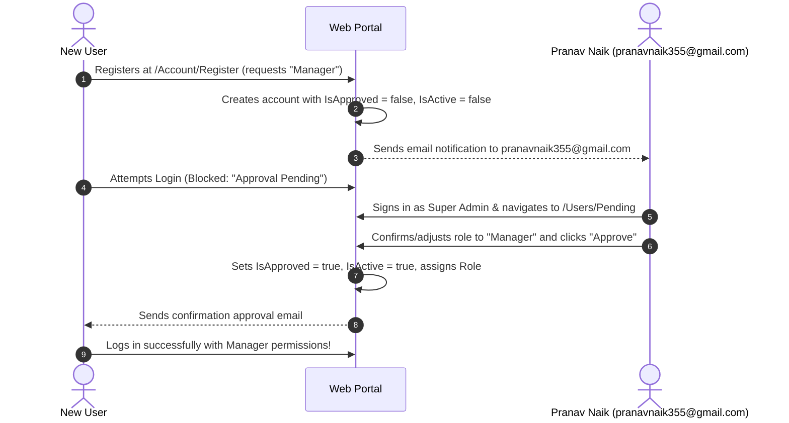
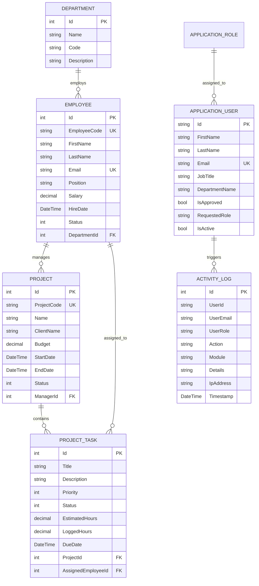
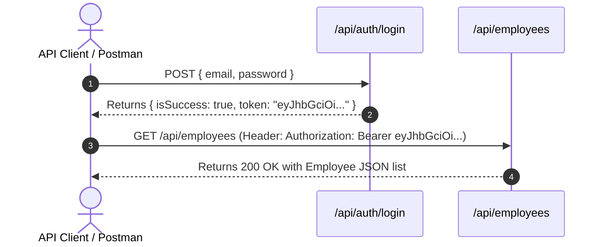

# 🏢 Pranav Enterprise — Comprehensive Engineering & Architectural Manual
> **From Fundamentals to Advanced Enterprise Implementation**  
> *A Complete Guide to ASP.NET Core 8, Clean Architecture, Dual Authentication, RBAC, RESTful APIs, and Enterprise Governance.*

---

## 📑 Table of Contents

1. [🔰 Level 1: Beginner Guide & Quickstart](#1--level-1-beginner-guide--quickstart)
   - 1.1 What is Pranav Enterprise?
   - 1.2 Running the Application (1-Click Launch)
   - 1.3 Demo Credentials Matrix (Pranav Naik, Amruta Naik, Shubham Naik, Ram Naik)
   - 1.4 How to Navigate the User Interface
2. [🔑 Level 2: Authentication, Authorization & RBAC Concepts](#2--level-2-authentication-authorization--rbac-concepts)
   - 2.1 Authentication vs. Authorization Explained
   - 2.2 What is Role-Based Access Control (RBAC)?
   - 2.3 The 4 RBAC Tiers & Permissions Matrix
   - 2.4 New Registration & Super Admin Approval Flow (`pranavnaik355@gmail.com`)
3. [🏗️ Level 3: Clean Architecture & System Design](#3--level-3-clean-architecture--system-design)
   - 3.1 What is Clean Architecture & Why Use It?
   - 3.2 Detailed Breakdown of the 4 Layers
   - 3.3 Dependency Injection (IoC) Service Container Map
4. [🗄️ Level 4: Database Design & Entity Framework Core](#4--level-4-database-design--entity-framework-core)
   - 4.1 Dual Database Engine: SQLite & Microsoft SQL Server
   - 4.2 Switching Between SQLite and SQL Server
   - 4.3 Complete Entity-Relationship (ER) Diagram
   - 4.4 Automated Data Seeding Engine (`DbInitializer`)
   - 4.5 Soft Deletion & Entity Auditing (`BaseEntity`, `IAuditableEntity`)
5. [🛡️ Level 5: Enterprise Security & Reliability Engineering](#5--level-5-enterprise-security--reliability-engineering)
   - 5.1 Dual Authentication: Cookies vs. JWT Tokens
   - 5.2 Password Cryptography (PBKDF2 + HMAC-SHA256)
   - 5.3 Brute-Force Defense & Account Lockout
   - 5.4 Cross-Site Request Forgery (CSRF / XSRF) Mitigation
   - 5.5 Centralized Exception Handling Middleware (RFC 7807)
   - 5.6 Immutable Activity Audit Trail
6. [📡 Level 6: Complete RESTful API Developer Guide](#6--level-6-complete-restful-api-developer-guide)
   - 6.1 How REST APIs Work in This Application
   - 6.2 Authentication Flow: Obtaining and Using a JWT Bearer Token
   - 6.3 Authentication APIs (`/api/auth`)
   - 6.4 Employees Directory APIs (`/api/employees`)
   - 6.5 Projects Portfolio APIs (`/api/projects`)
   - 6.6 Tasks Management APIs (`/api/tasks`)
   - 6.7 Executive Dashboard Analytics API (`/api/dashboard`)
   - 6.8 Complete cURL & PowerShell Script Examples
7. [🔄 Level 7: Business Workflows Walkthrough](#7--level-7-business-workflows-walkthrough)
   - 7.1 Workflow 1: User Self-Registration & Approval by Super Admin
   - 7.2 Workflow 2: Employee Lifecycle (Onboarding, Salary, Termination)
   - 7.3 Workflow 3: Project Lifecycle & Task Milestone Delivery
   - 7.4 Workflow 4: Security Auditing & Forensic Activity Tracking
8. [🧪 Level 8: Testing, Build & Production Deployment](#8--level-8-testing-build--production-deployment)
   - 8.1 Automated Unit Test Suite (xUnit)
   - 8.2 Building for Production (`dotnet publish`)
   - 8.3 Troubleshooting & FAQ

---

## 1. 🔰 Level 1: Beginner Guide & Quickstart

### 1.1 What is Pranav Enterprise?
**Pranav Enterprise** is a web platform designed to handle company operations:
- **Workforce Management**: Managing employee directory, compensation, departments, and active statuses.
- **Project Portfolio Governance**: Tracking corporate initiatives, deadlines, budgets, and milestone progress.
- **Task Delegation**: Assigning work items to employees, tracking priority, and logging work hours.
- **Executive Analytics**: Real-time KPI summary cards and interactive charts powered by Chart.js.
- **Security & RBAC**: Ensuring each user only sees and modifies data allowed by their role.

---

### 1.2 Running the Application (1-Click Launch)

#### Prerequisites
- [.NET 8.0 SDK](https://dotnet.microsoft.com/download/dotnet/8.0) or higher.
- Any modern web browser (Edge, Chrome, Firefox).

#### Command to Run
Open your terminal in the project directory (`D:\Pranav Enterprises`) and run:

```powershell
# 1. Restore & build
dotnet build

# 2. Run the application
dotnet run --project src/PranavEnterprises.Web/PranavEnterprises.Web.csproj --urls "http://localhost:5000"
```

Once started, open your browser and navigate to:
👉 **[http://localhost:5000](http://localhost:5000)**

> **Zero Configuration Required**: The database is automatically created and pre-populated with departments, employees, projects, tasks, and users on first run!

---

### 1.3 Demo Credentials Matrix

On the login page ([http://localhost:5000/Account/Login](http://localhost:5000/Account/Login)), click any of the **Quick Demo Login buttons** at the bottom to autofill credentials instantly.

> **Universal Master Demo Password**: `P@ssword123!`

| Role | User Name | Corporate Email | Password | Access Capabilities |
| :--- | :--- | :--- | :--- | :--- |
| **Super Admin** | **Pranav Naik** | `superadmin@pranav.com` | `P@ssword123!` | Full system control, Role approval queue, User provisioning/deletion, Security roles, Audit logs |
| **Admin** | **Amruta Naik** | `admin@pranav.com` | `P@ssword123!` | User management, Employee CRUD, Project portfolio CRUD, Tasks management |
| **Manager** | **Shubham Naik** | `manager@pranav.com` | `P@ssword123!` | Project & Task creation/management, Team milestone tracking |
| **Employee** | **Ram Naik** | `employee@pranav.com` | `P@ssword123!` | Assigned tasks execution, Status transitions, Profile management |

---

### 1.4 How to Navigate the User Interface

The web interface features an enterprise dashboard layout:
- **Left Sidebar**: Role-filtered navigation (modules only appear if your role is authorized).
- **Top Bar**: Search shortcut, notifications indicator, and current logged-in user profile dropdown.
- **Main Content**: Dynamic views with statistics cards, data tables with search filters, and modal dialogs for CRUD operations.

---

## 2. 🔑 Level 2: Authentication, Authorization & RBAC Concepts

### 2.1 Authentication vs. Authorization Explained

```
┌──────────────────────────────────────────────┐
│  1. AUTHENTICATION (Who are you?)            │
│  "I am Pranav Naik (superadmin@pranav.com)"   │
│  Verified via: Password / Cryptographic Salt │
└──────────────────────┬───────────────────────┘
                       │
                       ▼
┌──────────────────────────────────────────────┐
│  2. AUTHORIZATION (What can you do?)         │
│  Role: SuperAdmin                            │
│  Policy: RequireSuperAdmin                   │
│  Permissions: Approve users, delete projects │
└──────────────────────────────────────────────┘
```

- **Authentication (AuthN)**: Verifying the identity of the user. In Pranav Enterprise, this is handled through password hashing with PBKDF2/HMAC-SHA256.
- **Authorization (AuthZ)**: Verifying whether an authenticated user is permitted to perform a requested action or view a page.

---

### 2.2 What is Role-Based Access Control (RBAC)?
Instead of assigning individual permissions to each employee, permissions are grouped into **Roles**. Users are assigned to one of these roles, inheriting all permissions granted to that role.

---

### 2.3 The 4 RBAC Tiers & Permissions Matrix

| System Module / Capability | Super Admin (Pranav Naik) | Admin (Amruta Naik) | Manager (Shubham Naik) | Employee (Ram Naik) |
| :--- | :---: | :---: | :---: | :---: |
| **View Dashboard & KPIs** | ✅ | ✅ | ✅ | ✅ |
| **View Employee Directory** | ✅ | ✅ | ✅ | ✅ |
| **Create / Edit Employees** | ✅ | ✅ | ❌ | ❌ |
| **Delete Employees (Soft-Delete)** | ✅ | ✅ | ❌ | ❌ |
| **View Projects Portfolio** | ✅ | ✅ | ✅ | ✅ |
| **Create / Edit Projects** | ✅ | ✅ | ✅ | ❌ |
| **Delete Projects** | ✅ | ✅ | ❌ | ❌ |
| **View Task List** | ✅ | ✅ | ✅ | ✅ |
| **Create / Assign Tasks** | ✅ | ✅ | ✅ | ❌ |
| **Update Task Status** | ✅ | ✅ | ✅ | ✅ |
| **User Directory & Lock/Unlock** | ✅ | ✅ | ❌ | ❌ |
| **Delete User Accounts** | ✅ | ❌ | ❌ | ❌ |
| **Custom Security Roles** | ✅ | ❌ | ❌ | ❌ |
| **Approve Self-Registered Users** | ✅ | ❌ | ❌ | ❌ |
| **Activity & Audit Logs** | ✅ | ✅ | ❌ | ❌ |

---

### 2.4 New Registration & Super Admin Approval Flow (`pranavnaik355@gmail.com`)

To protect corporate data, self-registration incorporates a security gate:



1. **Self-Registration**: A user fills out the registration form at [`/Account/Register`](http://localhost:5000/Account/Register) and selects their desired role.
2. **Account Held in Pending**: Account is saved with `IsApproved = false` and `IsActive = false`. If the user attempts to log in before approval, the portal displays:
   > *"Your account is pending role approval by Super Admin (pranavnaik355@gmail.com). You will be notified once approved."*
3. **Email Notification**: An automated notification is sent to **`pranavnaik355@gmail.com`** with candidate details (name, email, department, job title, requested role) and a direct approval link.
4. **Approval Execution**: Super Admin (**Pranav Naik**) visits `/Users/Pending`, reviews the candidate, selects the approved role from the dropdown, and clicks **Approve**.
5. **Immediate Activation**: The account is activated, the role is assigned, and an approval confirmation email is dispatched to the candidate.

---

## 3. 🏗️ Level 3: Clean Architecture & System Design

### 3.1 What is Clean Architecture & Why Use It?
Clean Architecture organizes software so that **business rules and entities are completely independent of frameworks, databases, and UI components**. Dependencies only point inward:

```
┌────────────────────────────────────────────────────────┐
│  1. Presentation Layer (PranavEnterprises.Web)         │
│     MVC Controllers, REST APIs, Razor Views, CSS/JS    │
└───────────────────────────┬────────────────────────────┘
                            │ depends on
                            ▼
┌────────────────────────────────────────────────────────┐
│  2. Application Layer (PranavEnterprises.Application)  │
│     Service Interfaces, DTOs, Business Validations     │
└───────────────────────────┬────────────────────────────┘
                            │ depends on
                            ▼
┌────────────────────────────────────────────────────────┐
│  3. Domain Layer (PranavEnterprises.Domain)            │
│     Core Business Entities, Enums, Auditing Interfaces │
└────────────────────────────────────────────────────────┘
                            ▲
                            │ implements
┌───────────────────────────┴────────────────────────────┐
│  4. Infrastructure Layer (PranavEnterprises.Infras.)   │
│     EF Core DbContext, SQL Server/SQLite, JWT, Email   │
└────────────────────────────────────────────────────────┘
```

**Benefits**:
- **Testability**: Business logic can be tested in isolation without a real database.
- **Database Independence**: The database can be swapped between SQLite and SQL Server by changing one configuration value.
- **Maintainability**: Changes in the UI or database never break core business rules.

---

### 3.2 Detailed Breakdown of the 4 Layers

#### Layer 1: `PranavEnterprises.Domain`
- **Location**: `src/PranavEnterprises.Domain`
- **Zero External Dependencies**: Contains pure C# classes.
- **Contents**:
  - `Entities/`: `ApplicationUser`, `ApplicationRole`, `Employee`, `Project`, `ProjectTask`, `Department`, `ActivityLog`.
  - `Common/`: `BaseEntity` (Id, IsDeleted, DeletedAt), `IAuditableEntity` (CreatedAt, CreatedBy, UpdatedAt, UpdatedBy).
  - `Enums/`: `EmployeeStatus`, `ProjectStatus`, `PriorityLevel`, `TaskItemStatus`.
  - `Constants/`: `AppRoles` (SuperAdmin, Admin, Manager, Employee), `AppPolicies`.

#### Layer 2: `PranavEnterprises.Application`
- **Location**: `src/PranavEnterprises.Application`
- **Depends only on**: `Domain`.
- **Contents**:
  - `Interfaces/`: `IAuthService`, `IEmployeeService`, `IProjectService`, `ITaskService`, `IDashboardService`, `IUserService`, `IRoleService`, `IActivityLogService`, `IEmailSenderService`.
  - `DTOs/`: Data Transfer Objects used to transfer data across network boundaries (`LoginDto`, `RegisterDto`, `EmployeeDto`, `ProjectDto`, `TaskDto`, `DashboardSummaryDto`).

#### Layer 3: `PranavEnterprises.Infrastructure`
- **Location**: `src/PranavEnterprises.Infrastructure`
- **Depends on**: `Application` and `Domain`.
- **Contents**:
  - `Data/ApplicationDbContext.cs`: EF Core context configuring relationships, cascade behaviors, and automated audit timestamp updates.
  - `Data/DbInitializer.cs`: Seeding engine for roles, default users, departments, employees, projects, and tasks.
  - `Services/`: Concrete implementations of all Application interfaces (`AuthService`, `EmployeeService`, `ProjectService`, `TaskService`, `DashboardService`, `UserService`, `RoleService`, `ActivityLogService`, `EmailSenderService`, `JwtTokenService`).

#### Layer 4: `PranavEnterprises.Web`
- **Location**: `src/PranavEnterprises.Web`
- **Presentation Layer**: Entry point of the web application.
- **Contents**:
  - `Controllers/`: MVC controllers (`Account`, `Dashboard`, `Employees`, `Projects`, `Tasks`, `Users`, `Roles`, `ActivityLogs`).
  - `Controllers/Api/`: RESTful API controllers (`AuthApiController`, `EmployeesApiController`, `ProjectsApiController`, `TasksApiController`, `DashboardApiController`).
  - `Middleware/`: `ExceptionHandlingMiddleware` for centralized error logging and RFC 7807 responses.
  - `Views/`: Razor views styled with Bootstrap 5.

---

### 3.3 Dependency Injection (IoC) Service Container Map

Configured in [`Program.cs`](file:///d:/Pranav%20Enterprises/src/PranavEnterprises.Web/Program.cs#L116-L126):

```csharp
// Business Services (Scoped: 1 instance per HTTP request)
builder.Services.AddScoped<IAuthService, AuthService>();
builder.Services.AddScoped<IEmployeeService, EmployeeService>();
builder.Services.AddScoped<IProjectService, ProjectService>();
builder.Services.AddScoped<ITaskService, TaskService>();
builder.Services.AddScoped<IDashboardService, DashboardService>();
builder.Services.AddScoped<IUserService, UserService>();
builder.Services.AddScoped<IRoleService, RoleService>();
builder.Services.AddScoped<IActivityLogService, ActivityLogService>();
builder.Services.AddScoped<IEmailSenderService, EmailSenderService>();

// Utility Services (Singleton: 1 instance for application lifetime)
builder.Services.AddSingleton<JwtTokenService>();
```

---

## 4. 🗄️ Level 4: Database Design & Entity Framework Core

### 4.1 Dual Database Engine: SQLite & Microsoft SQL Server
The application features a built-in provider toggle configured in [`Program.cs`](file:///d:/Pranav%20Enterprises/src/PranavEnterprises.Web/Program.cs#L17-L33):

```csharp
var dbProvider = builder.Configuration["DatabaseProvider"] ?? "Sqlite";
var connectionString = dbProvider.Equals("SqlServer", StringComparison.OrdinalIgnoreCase)
    ? builder.Configuration.GetConnectionString("DefaultConnection")
    : builder.Configuration.GetConnectionString("SqliteConnection");

builder.Services.AddDbContext<ApplicationDbContext>(options =>
{
    if (dbProvider.Equals("SqlServer", StringComparison.OrdinalIgnoreCase))
        options.UseSqlServer(connectionString);
    else
        options.UseSqlite(connectionString);
});
```

---

### 4.2 Switching Between SQLite and SQL Server

In `src/PranavEnterprises.Web/appsettings.json`:

#### Option A: SQLite (Default, Zero-Setup)
```json
{
  "DatabaseProvider": "Sqlite",
  "ConnectionStrings": {
    "SqliteConnection": "Data Source=PranavEnterprises.db"
  }
}
```

#### Option B: Microsoft SQL Server (Production)
```json
{
  "DatabaseProvider": "SqlServer",
  "ConnectionStrings": {
    "DefaultConnection": "Server=localhost;Database=PranavEnterprisesDb;Trusted_Connection=True;MultipleActiveResultSets=true;TrustServerCertificate=True"
  }
}
```

---

### 4.3 Complete Entity-Relationship (ER) Diagram



---

### 4.4 Automated Data Seeding Engine (`DbInitializer`)
On application startup, [`DbInitializer.SeedAsync(...)`](file:///d:/Pranav%20Enterprises/src/PranavEnterprises.Infrastructure/Data/DbInitializer.cs) verifies and provisions default entities:
- **Roles**: Super Admin, Admin, Manager, Employee.
- **Users**: Pranav Naik, Amruta Naik, Shubham Naik, Ram Naik.
- **Departments**: Software Engineering, Product Management, QA & DevOps, HR, Finance, Sales.
- **Employees**: 9 pre-seeded corporate workforce members across departments.
- **Projects**: 5 strategic client projects with budgets, timelines, and managers.
- **Tasks**: 7 work items across development, testing, and deployment.
- **Audit Logs**: Initial system startup events.

---

### 4.5 Soft Deletion & Entity Auditing

All primary entities inherit from [`BaseEntity`](file:///d:/Pranav%20Enterprises/src/PranavEnterprises.Domain/Common/BaseEntity.cs):
```csharp
public abstract class BaseEntity
{
    public int Id { get; set; }
    public bool IsDeleted { get; set; } = false;
    public DateTime? DeletedAt { get; set; }
}
```

- When an employee or project is deleted, `IsDeleted` is set to `true`.
- In `ApplicationDbContext`, EF Core **Global Query Filters** automatically hide soft-deleted records:
  ```csharp
  modelBuilder.Entity<Employee>().HasQueryFilter(e => !e.IsDeleted);
  modelBuilder.Entity<Project>().HasQueryFilter(p => !p.IsDeleted);
  modelBuilder.Entity<ProjectTask>().HasQueryFilter(t => !t.IsDeleted);
  ```
- This ensures data is never accidentally lost and preserves audit trails for regulatory compliance.

---

## 5. 🛡️ Level 5: Enterprise Security & Reliability Engineering

### 5.1 Dual Authentication: Cookies vs. JWT Tokens

Pranav Enterprise implements a **dual authentication scheme**:

```
┌─────────────────────────────────────────────────────────────┐
│                       Incoming Request                      │
└──────────────┬──────────────────────────────┬───────────────┘
               │ Browser                      │ API Client / Mobile
               ▼                              ▼
┌─────────────────────────────┐┌──────────────────────────────┐
│ CookieAuthentication        ││ JwtBearerAuthentication      │
│ • Sliding expiration (8 hrs)││ • Header: Bearer <token>     │
│ • HttpOnly, SameSite=Lax    ││ • HMAC-SHA256 signature      │
│ • Anti-Forgery token checked││ • Stateless & scalable       │
└─────────────────────────────┘└──────────────────────────────┘
```

1. **Cookie Authentication**: Protects interactive MVC web sessions with secure, sliding HTTP-only cookies and CSRF prevention.
2. **JWT Bearer Authentication**: Protects RESTful APIs with digitally signed, stateless JSON Web Tokens.

---

### 5.2 Password Cryptography (PBKDF2 + HMAC-SHA256)
Passwords are never stored in plaintext. They are hashed using ASP.NET Core Identity's implementation:
- **Algorithm**: PBKDF2 with HMAC-SHA256.
- **Salt**: 128-bit cryptographically secure per-user salt.
- **Iterations**: 10,000+ key derivation iterations.

---

### 5.3 Brute-Force Defense & Account Lockout
Configured in [`Program.cs`](file:///d:/Pranav%20Enterprises/src/PranavEnterprises.Web/Program.cs#L45-L49):
- **Maximum Failed Attempts**: 5 consecutive failed logins.
- **Lockout Duration**: 5 minutes automatic lockout.
- Prevents automated credential-stuffing and dictionary attacks.

---

### 5.4 Cross-Site Request Forgery (CSRF / XSRF) Mitigation
All MVC forms generate a cryptographic Anti-Forgery token via `@Html.AntiForgeryToken()`. POST requests are validated with `[ValidateAntiForgeryToken]`. Tampered or missing tokens are rejected with HTTP 400.

---

### 5.5 Centralized Exception Handling Middleware (RFC 7807)

Implemented in [`ExceptionHandlingMiddleware.cs`](file:///d:/Pranav%20Enterprises/src/PranavEnterprises.Web/Middleware/ExceptionHandlingMiddleware.cs):

```csharp
try
{
    await _next(context);
}
catch (Exception ex)
{
    await HandleExceptionAsync(context, ex);
}
```

- **For API Requests (`/api/*`)**: Returns standard **RFC 7807 Problem Details** JSON response:
  ```json
  {
    "statusCode": 500,
    "message": "An unexpected server error occurred.",
    "traceId": "0HN8R9A2B4C1D",
    "timestamp": "2026-11-08T11:20:00Z"
  }
  ```
- **For MVC Requests**: Logs the exception and presents a polished error page to the user.

---

### 5.6 Immutable Activity Audit Trail
Every security-sensitive operation (Login, Register, ApproveRole, Create, Update, Delete) is recorded via [`ActivityLogService.cs`](file:///d:/Pranav%20Enterprises/src/PranavEnterprises.Infrastructure/Services/ActivityLogService.cs):
- Captures: `UserId`, `UserEmail`, `UserRole`, `Action`, `Module`, `EntityId`, `Details`, `IPAddress`, and `Timestamp`.
- Accessible by Super Admin and Admin via the **Activity Logs** portal.

---

## 6. 📡 Level 6: Complete RESTful API Developer Guide

### 6.1 How REST APIs Work in This Application
- All REST API routes begin with the prefix `/api/`.
- All requests and responses use `application/json`.
- Protected endpoints require an `Authorization: Bearer <jwt_token>` header.

---

### 6.2 Authentication Flow: Obtaining and Using a JWT Bearer Token



---

### 6.3 Authentication APIs (`/api/auth`)

#### 1. Login (Authenticate & Obtain JWT Token)
- **Endpoint**: `POST /api/auth/login`
- **Authorization**: Anonymous (Public)
- **Request Body**:
  ```json
  {
    "email": "superadmin@pranav.com",
    "password": "P@ssword123!",
    "rememberMe": true
  }
  ```
- **Response (200 OK)**:
  ```json
  {
    "isSuccess": true,
    "message": "Authentication successful",
    "token": "eyJhbGciOiJIUzI1NiIsInR5cCI6IkpXVCJ9...",
    "expiration": "2026-11-08T14:20:00Z",
    "userId": "1a2b3c4d-...",
    "fullName": "Pranav Naik",
    "email": "superadmin@pranav.com",
    "role": "Super Admin"
  }
  ```

#### 2. Register (Submit Registration for Role Approval)
- **Endpoint**: `POST /api/auth/register`
- **Authorization**: Anonymous (Public)
- **Request Body**:
  ```json
  {
    "firstName": "Rajesh",
    "lastName": "Kulkarni",
    "email": "rajesh.kulkarni@pranav.com",
    "jobTitle": "Tech Lead",
    "departmentName": "Software Engineering",
    "role": "Manager",
    "password": "P@ssword123!",
    "confirmPassword": "P@ssword123!"
  }
  ```
- **Response (200 OK)**:
  ```json
  {
    "isSuccess": true,
    "message": "Registration submitted successfully! An approval dispatch has been sent to Super Admin (pranavnaik355@gmail.com). You can log in once approved.",
    "userId": "604f734c-...",
    "fullName": "Rajesh Kulkarni",
    "email": "rajesh.kulkarni@pranav.com",
    "role": "Manager"
  }
  ```

---

### 6.4 Employees Directory APIs (`/api/employees`)

| Method | Endpoint | Authorization | Description |
| :--- | :--- | :--- | :--- |
| `GET` | `/api/employees` | Authenticated | List employees (supports `?search=` and `?departmentId=`) |
| `GET` | `/api/employees/{id}` | Authenticated | Get employee by ID |
| `POST` | `/api/employees` | OperationalAccess (SuperAdmin, Admin) | Create a new employee |
| `PUT` | `/api/employees/{id}` | OperationalAccess (SuperAdmin, Admin) | Update an employee record |
| `DELETE` | `/api/employees/{id}` | ManagementAccess (SuperAdmin, Admin) | Soft-delete an employee |

#### Create Employee Sample Request (`POST /api/employees`):
```json
{
  "employeeCode": "EMP-2005",
  "firstName": "Aarav",
  "lastName": "Naik",
  "email": "aarav.naik@pranav.com",
  "phone": "+91 98111 22334",
  "position": "Cloud Solutions Architect",
  "salary": 145000,
  "hireDate": "2026-01-15T00:00:00Z",
  "status": 1,
  "departmentId": 1
}
```

---

### 6.5 Projects Portfolio APIs (`/api/projects`)

| Method | Endpoint | Authorization | Description |
| :--- | :--- | :--- | :--- |
| `GET` | `/api/projects` | Authenticated | List all strategic projects |
| `GET` | `/api/projects/{id}` | Authenticated | Get project details, milestones, and task counts |
| `POST` | `/api/projects` | OperationalAccess (SuperAdmin, Admin, Manager) | Launch a new project |
| `PUT` | `/api/projects/{id}` | OperationalAccess (SuperAdmin, Admin, Manager) | Update project parameters |
| `PATCH` | `/api/projects/{id}/status` | OperationalAccess (SuperAdmin, Admin, Manager) | Transition project status |
| `DELETE` | `/api/projects/{id}` | ManagementAccess (SuperAdmin, Admin) | Soft-delete a project |

#### Create Project Sample Request (`POST /api/projects`):
```json
{
  "projectCode": "PRJ-FIN-01",
  "name": "Enterprise Payment Gateway 3.0",
  "description": "Next-gen zero-latency payment processing engine with AI fraud prevention.",
  "clientName": "Apex Financial Group",
  "budget": 250000,
  "startDate": "2026-03-01T00:00:00Z",
  "endDate": "2026-11-30T00:00:00Z",
  "status": 1,
  "managerId": 1
}
```

---

### 6.6 Tasks Management APIs (`/api/tasks`)

| Method | Endpoint | Authorization | Description |
| :--- | :--- | :--- | :--- |
| `GET` | `/api/tasks` | Authenticated | List tasks (supports `?projectId=` and `?status=`) |
| `GET` | `/api/tasks/{id}` | Authenticated | Get task by ID |
| `POST` | `/api/tasks` | OperationalAccess (SuperAdmin, Admin, Manager) | Assign a new work task |
| `PUT` | `/api/tasks/{id}` | OperationalAccess (SuperAdmin, Admin, Manager) | Update task details & logged hours |
| `PATCH` | `/api/tasks/{id}/status` | Authenticated (Assigned Employee / Manager) | Quick status transition |
| `DELETE` | `/api/tasks/{id}` | ManagementAccess (SuperAdmin, Admin) | Soft-delete a task |

---

### 6.7 Executive Dashboard Analytics API (`/api/dashboard`)

- **Endpoint**: `GET /api/dashboard/summary`
- **Authorization**: Authenticated (All Roles)
- **Response (200 OK)**:
  ```json
  {
    "totalEmployees": 9,
    "activeProjects": 4,
    "completedProjects": 1,
    "totalTasks": 7,
    "completedTasks": 3,
    "taskCompletionRate": 42.9,
    "totalBudgetManaged": 1420000.00,
    "departmentHeadcounts": {
      "Software Engineering": 3,
      "Product Management": 1,
      "Quality Assurance & DevOps": 2,
      "Human Resources": 1,
      "Finance & Accounting": 1,
      "Sales & Client Success": 1
    },
    "projectsByStatus": {
      "Planning": 1,
      "InProgress": 3,
      "Completed": 1
    },
    "tasksByStatus": {
      "ToDo": 2,
      "InProgress": 2,
      "InReview": 0,
      "Done": 3
    }
  }
  ```

---

### 6.8 Complete cURL & PowerShell Script Examples

#### PowerShell Script (End-to-End API Execution)
```powershell
# 1. Login to obtain JWT Token
$loginBody = @{
    email = "superadmin@pranav.com"
    password = "P@ssword123!"
} | ConvertTo-Json

$auth = Invoke-RestMethod -Uri "http://localhost:5000/api/auth/login" -Method Post -Body $loginBody -ContentType "application/json"
$token = $auth.token
Write-Host "Authenticated as: $($auth.fullName) [Role: $($auth.role)]"

# 2. Fetch Executive Dashboard Summary
$dashboard = Invoke-RestMethod -Uri "http://localhost:5000/api/dashboard/summary" -Headers @{ Authorization = "Bearer $token" }
Write-Host "Total Employees: $($dashboard.totalEmployees)"
Write-Host "Active Projects: $($dashboard.activeProjects)"
Write-Host "Budget Managed: $($dashboard.totalBudgetManaged)"

# 3. Fetch Employees Directory
$employees = Invoke-RestMethod -Uri "http://localhost:5000/api/employees" -Headers @{ Authorization = "Bearer $token" }
$employees | Format-Table id, employeeCode, fullName, position, salary
```

#### cURL (Bash / Linux / Mac / Command Prompt)
```bash
# 1. Login
curl -X POST "http://localhost:5000/api/auth/login" \
     -H "Content-Type: application/json" \
     -d '{"email":"superadmin@pranav.com","password":"P@ssword123!"}'

# 2. Call Employees API using Token
curl -X GET "http://localhost:5000/api/employees" \
     -H "Authorization: Bearer <paste_token_here>"
```

---

## 7. 🔄 Level 7: Business Workflows Walkthrough

### 7.1 Workflow 1: User Self-Registration & Approval by Super Admin
1. Candidate goes to `/Account/Register`.
2. Candidate submits name, corporate email, department, job title, and requested role (e.g., Manager).
3. System sends an automated notification email to **`pranavnaik355@gmail.com`**.
4. Super Admin (**Pranav Naik**) logs in and visits **Administration & RBAC > Role Approvals** (`/Users/Pending`).
5. Super Admin selects/confirms role and clicks **Approve**.
6. The candidate is activated and receives an approval notification email. They can now log in.

---

### 7.2 Workflow 2: Employee Lifecycle (Onboarding, Salary, Termination)
1. Admin navigates to **Workforce > Employees Directory** (`/Employees`).
2. Clicks **Add Employee**, enters details (Employee Code, Department, Salary, Hire Date).
3. Employee is immediately available for project task assignment.
4. When changing roles, Admin clicks **Edit** to update position and compensation.
5. In case of offboarding, Admin clicks **Terminate/Delete**; the record is soft-deleted, preserving historical task completion records without breaking foreign keys.

---

### 7.3 Workflow 3: Project Lifecycle & Task Milestone Delivery
1. Manager creates a project under **Portfolio > Projects** (`/Projects`) with budget and target launch date.
2. Manager breaks down milestones into tasks under **Operations > Tasks** (`/Tasks`), setting priority and assigning to engineers.
3. Employee (**Ram Naik**) logs in, views assigned tasks, and moves tasks from **To Do** ➡️ **In Progress** ➡️ **Done**, logging actual hours.
4. Executive Dashboard updates real-time completion velocity and productivity charts.

---

### 7.4 Workflow 4: Security Auditing & Forensic Activity Tracking
1. Super Admin navigates to **Administration & RBAC > Activity Logs** (`/ActivityLogs`).
2. Displays chronological, tamper-evident log entries recording every user login, registration, role update, employee edit, and project deletion.
3. Filterable by Module, Action, or User.

---

## 8. 🧪 Level 8: Testing, Build & Production Deployment

### 8.1 Automated Unit Test Suite (xUnit)
The solution includes unit tests in [`tests/PranavEnterprises.Tests`](file:///d:/Pranav%20Enterprises/tests/PranavEnterprises.Tests):

```powershell
# Run all unit tests
dotnet test
```

**Test Coverage**:
- `EmployeeServiceTests`: Employee creation, duplicate code validation, soft deletion, audit verification.
- `ProjectServiceTests`: Project calculations, status updates.
- `JwtTokenServiceTests`: Token generation, claim verification, signature validation.

---

### 8.2 Building for Production (`dotnet publish`)
To generate an optimized, self-contained production deployment bundle:

```powershell
# Publish release build
dotnet publish src/PranavEnterprises.Web/PranavEnterprises.Web.csproj -c Release -o ./publish
```

This compiles all Razor views, bundles static assets, generates optimized binaries, and outputs a production-ready package in `./publish`.

---

### 8.3 Troubleshooting & FAQ

#### Q: How do I change the database from SQLite to Microsoft SQL Server?
**A**: Open `src/PranavEnterprises.Web/appsettings.json`, set `"DatabaseProvider": "SqlServer"`, and ensure your `"DefaultConnection"` string points to your running SQL Server instance.

#### Q: What is the master password for testing demo accounts?
**A**: `P@ssword123!` works for all demo accounts:
- Super Admin: `superadmin@pranav.com`
- Admin: `admin@pranav.com`
- Manager: `manager@pranav.com`
- Employee: `employee@pranav.com`

#### Q: Where are registration notification emails sent?
**A**: All new registration notifications are dispatched to **`pranavnaik355@gmail.com`**.

---

*Authored by the Pranav Enterprises Software Engineering & Architecture Team &bull; 2026*
